<p align="center">
  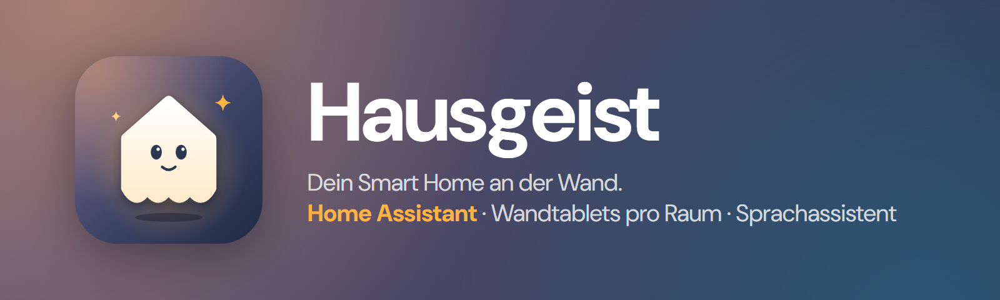
</p>

<p align="center">
  <a href="https://github.com/gottschalkfelix4-source/hausgeist/actions/workflows/docker.yml"></a>
  <a href="https://github.com/gottschalkfelix4-source/hausgeist/actions/workflows/app.yml"></a>
  <a href="https://github.com/gottschalkfelix4-source/hausgeist/releases/latest"></a>
  <a href="LICENSE"></a>
</p>

**Hausgeist** macht günstige Android-Tablets zu Wand-Bedienfeldern für **Home Assistant**.
Jedes Tablet gehört zu einem Raum und zeigt nur dessen Geräte, im Stil von Apple Home.
Ein Sprachassistent steuert per Sprache, ebenfalls nur im eigenen Raum.
Das Display bleibt immer bereit. Es wird hell, sobald jemand davor steht, und dunkel, wenn niemand im Raum ist.

<p align="center">
  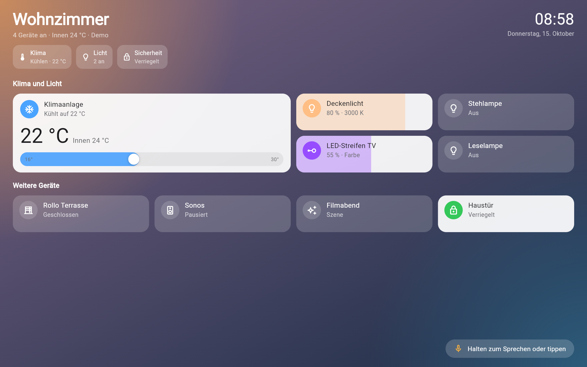
</p>

## Inhalt
- [Funktionen](#funktionen)
- [Screenshots](#screenshots)
- [So funktioniert es](#so-funktioniert-es)
- [Installation](#installation)
  - [1. Server auf Unraid](#1-server-auf-unraid)
  - [2. Räume und Tablets anlegen](#2-räume-und-tablets-anlegen)
  - [3. Tablet einrichten](#3-tablet-einrichten)
  - [Updates](#updates)
- [Web-Verwaltung](#web-verwaltung)
- [Display-Verhalten](#display-verhalten)
- [Sprachassistent](#sprachassistent)
- [Konfiguration](#konfiguration)
- [Zugriff von außen / HTTPS](#zugriff-von-außen--https)
- [API](#api)
- [Entwicklung](#entwicklung)
- [Datenschutz](#datenschutz)
- [Roadmap](#roadmap)

## Funktionen

| | |
|---|---|
| 🏠 **Ein Tablet, ein Raum** | Jedes Tablet gehört zu einem Raum. Es sieht und steuert nur die Geräte dieses Raums. Mehrere Tablets pro Raum sind kein Problem. |
| 🖥️ **Web-Verwaltung** | Alles im Browser: Ein Assistent führt durch die Ersteinrichtung. Home Assistant, API-Schlüssel, Modelle und Stimmen einstellen und direkt testen. Räume, Geräte, Präsenzmelder, Tablets und Display-Verhalten verwalten. Sicherung als Datei. |
| 🔢 **Koppeln per Code** | Tablet anlegen, 6-stelligen Code in der App eintippen, fertig. Kein Token abtippen. |
| 💡 **Licht** | Ein/aus, Helligkeit per Wischen über die Kachel, Farbrad, Weißtöne in Kelvin, Favoriten. |
| ❄️ **Klima** | Drehregler für die Zieltemperatur, Modi (Kühlen, Heizen, Automatik, Entfeuchten, Lüften), Lüfterstufe, Lamellen, Eco. |
| 🪟 **Rollos, Musik, Szenen, Schlösser** | Position, Lautstärke und Titel, Szenen per Tipp, Türschloss. |
| 🗣️ **Sprachassistent** | Einfach „Computer“ sagen (das Wort ist frei wählbar) oder aufs Mikro tippen. Eine leuchtende Kugel zeigt, dass zugehört wird, und bewegt sich mit der Stimme. Hören mehrere Tablets den Ruf, antwortet nur das, bei dem gerade jemand ist. Das Aktivierungswort erkennt das Tablet selbst, ohne Internet. Spracherkennung mit OpenAI oder Grok, Sprachmodell OpenAI, Grok (xAI) oder ein eigenes wie Ollama, Antwortstimme mit ElevenLabs, OpenAI oder Grok. Oder ein **Live-Sprachmodell** (GPT-Live-1, Grok Voice 3.0), das selbst hört und spricht. Er merkt sich die letzten Sätze, „und jetzt etwas dunkler“ funktioniert also. |
| 👋 **Wird hell bei Annäherung** | Die Frontkamera erkennt, wenn jemand vor das Tablet tritt. Antippen ist nicht nötig. Wer hinten im Raum vorbeigeht, weckt es nicht. |
| 🌙 **Blendet nicht** | Die Helligkeit folgt dem Raumlicht. Nachts gibt es eine Obergrenze und ein dunkles Design. |
| 🔁 **Live** | Änderungen aus Home Assistant erscheinen sofort, nach einem Verbindungsabbruch verbindet sich die App selbst neu. |
| ⬆️ **Update-Hinweis** | Gibt es ein neues Release, zeigt das Tablet einen Hinweis und lädt die neue APK auf Fingertipp. |
| 🧪 **Demo-Modus** | Die App lässt sich ohne Server mit Beispielgeräten ausprobieren. |

## Screenshots

| Licht mit Weißtönen | Farblicht |
|---|---|
| 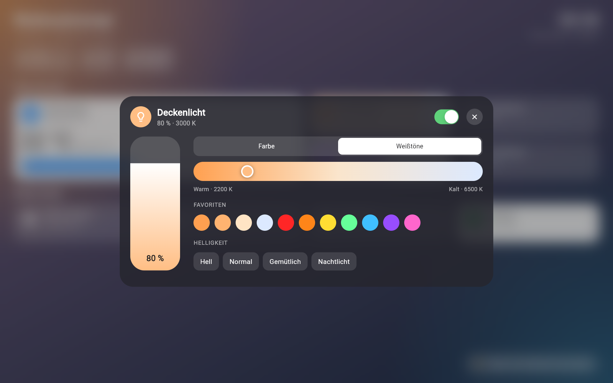 | 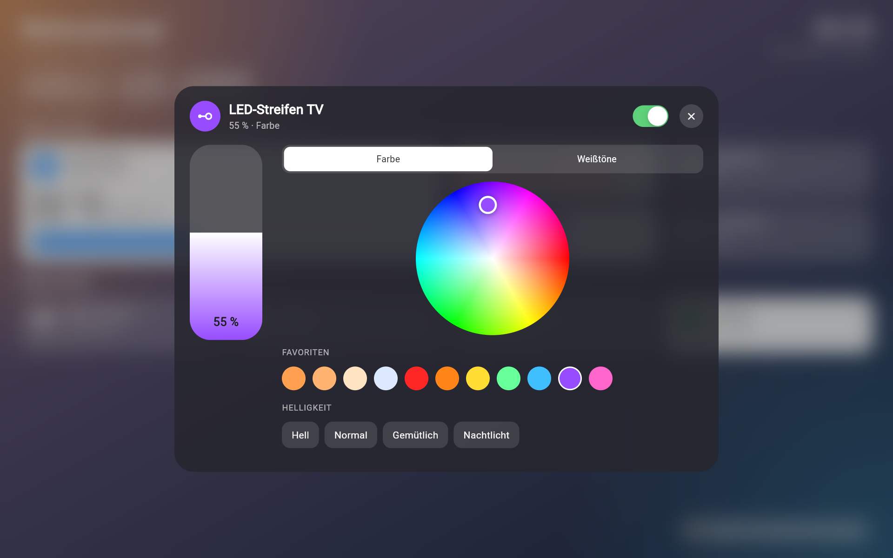 |
| **Sprachassistent hört zu** | **… und antwortet** |
| 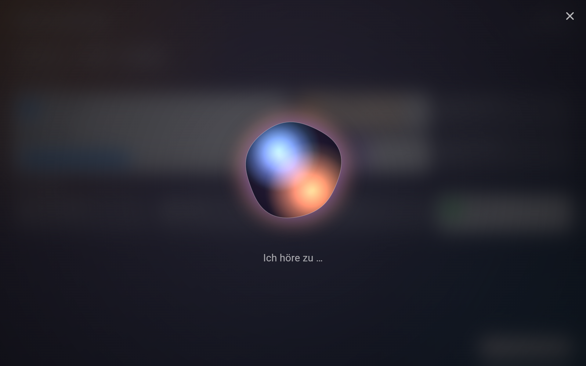 | 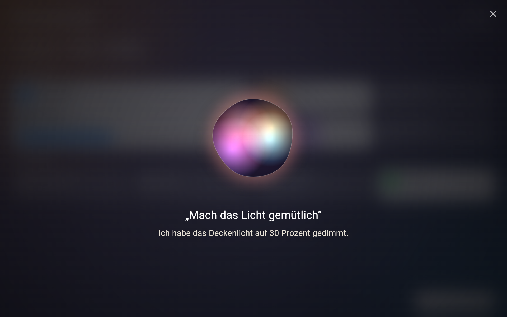 |
| **Klimaanlage** | |
| 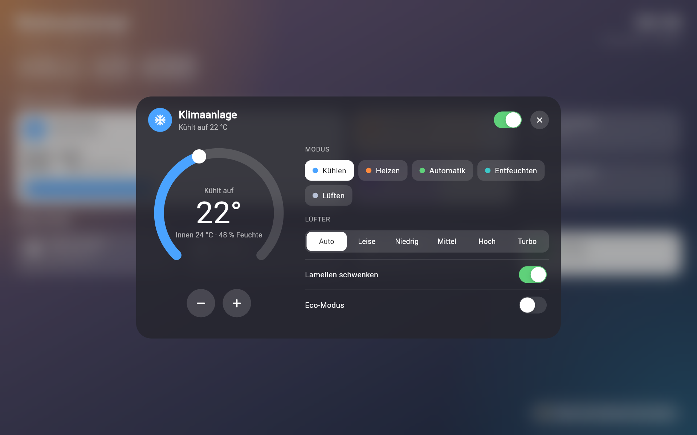 | |
| **Einrichtung mit Kopplungscode** | **Nachts** |
| 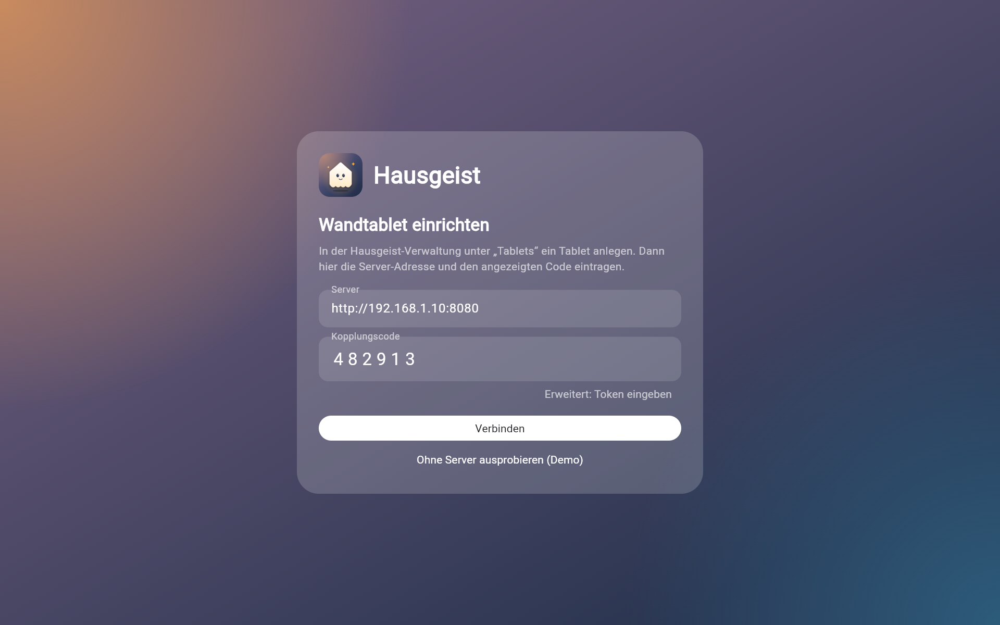 | 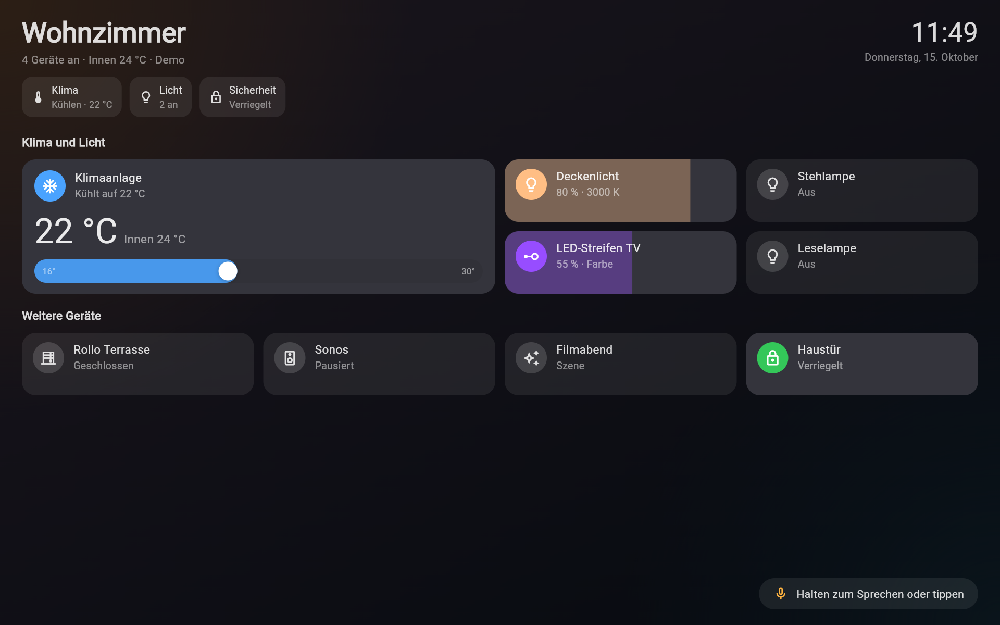 |
| **Hochformat** | |
| 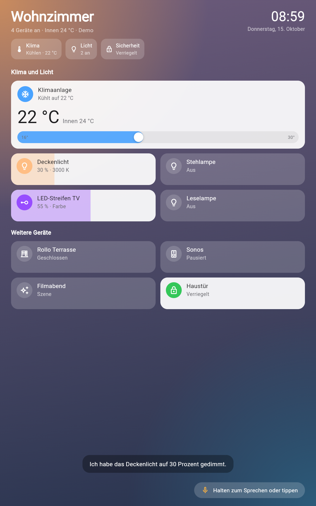 | |

## So funktioniert es

```
Geräte (Zigbee, Hue, Klima, …) ──► Home Assistant
                                       │  REST + WebSocket
                                       ▼
                              Hausgeist-Server (Docker, z. B. Unraid)
                              • Räume, Tablets, Zuordnung (SQLite), Web-Verwaltung
                              • Live-Zustände, nach Raum gefiltert
                              • Sprache: STT ─► LLM mit Tool-Calling ─► TTS
                                       │  WLAN, Token pro Tablet
                                       ▼
                     Hausgeist-App auf den Wandtablets (Android)
```

Home Assistant bleibt die Basis für alle Geräte. Hausgeist ist die Schicht darüber: Es weiß, welches
Tablet in welchem Raum hängt, filtert die Geräte und führt den Sprachassistenten aus. Details stehen in
[docs/ARCHITECTURE.md](docs/ARCHITECTURE.md).

## Installation

Du brauchst:
- Home Assistant mit einem **Long-Lived Access Token** (in Home Assistant: Profil → Sicherheit → *Langlebige Zugriffstoken*)
- einen Docker-Host, zum Beispiel Unraid
- ein oder mehrere Android-Tablets (Android 7 oder neuer, Frontkamera empfohlen)
- für Sprache: einen OpenAI- oder xAI-API-Key, optional ElevenLabs oder ein eigenes Sprachmodell (Ollama, LM Studio)

### 1. Server auf Unraid

**Mit dem Template:**

1. Unraid-Terminal öffnen und das Template herunterladen:
   ```bash
   wget -O /boot/config/plugins/dockerMan/templates-user/my-hausgeist.xml https://raw.githubusercontent.com/gottschalkfelix4-source/hausgeist/main/unraid/hausgeist.xml
   ```
2. **Docker → Add Container** → bei *Template* „Hausgeist“ auswählen.
3. **Apply**. Ausfüllen musst du nichts: Home Assistant, Schlüssel und Sprachdienste stellst du danach in
   der Verwaltung ein. Wer will, kann sie unter *Show more settings* auch hier eintragen.
4. Die Verwaltung öffnest du über das Container-Icon → **WebUI** oder unter `http://<unraid-ip>:8080/admin/`.

**Mit Docker Compose (jeder Docker-Host):**

```bash
git clone https://github.com/gottschalkfelix4-source/hausgeist.git
cd hausgeist
cp backend/.env.example backend/.env   # optional, alles geht auch in der Verwaltung
docker compose up -d
```

Das Image `ghcr.io/gottschalkfelix4-source/hausgeist` gibt es für `amd64` und `arm64`.

### 2. Einrichten im Browser

Öffne `http://<server>:8080/admin/`. Beim ersten Aufruf legst du ein **Passwort für die Verwaltung** fest.
Mach das gleich nach dem Start, denn bis dahin kann es jeder im Heimnetz tun.

Danach führt ein Assistent in vier Schritten durch die Einrichtung. Jeden Schritt kannst du überspringen
und später unter **Einstellungen** oder über die Checkliste in der **Übersicht** nachholen.

1. **Home Assistant:** Adresse und Token eintragen, **Verbindung testen**, speichern.
2. **Sprachassistent:** Sprachmodell (OpenAI, Grok oder ein eigenes), Stimme (ElevenLabs, OpenAI oder Grok) und
   die nötigen API-Schlüssel. Beim Speichern prüft Hausgeist, ob das Sprachmodell antwortet.
3. **Räume:** Mit **Aus Home Assistant übernehmen** legt Hausgeist für jeden Bereich (Area) einen Raum an
   und ordnet die Geräte zu. Gibt es im Bereich genau einen Präsenzmelder, wird er automatisch eingetragen.
   Räume lassen sich auch von Hand anlegen.
4. **Tablet:** Name und Raum wählen. Es erscheint ein **Kopplungscode**, der 15 Minuten gilt.

<p align="center">
  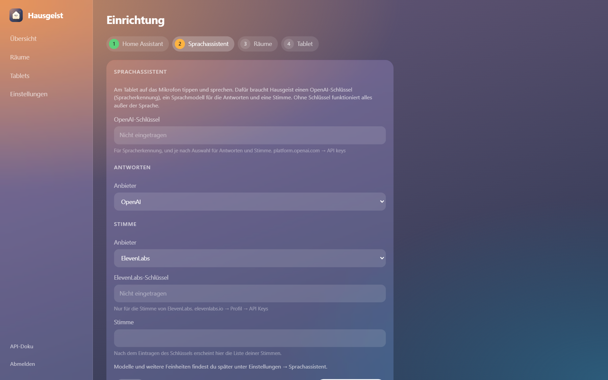
</p>

Geräte eines Raums änderst du später unter **Räume**: Raum öffnen, Geräte an- oder abwählen, Präsenzmelder ändern.

<p align="center">
  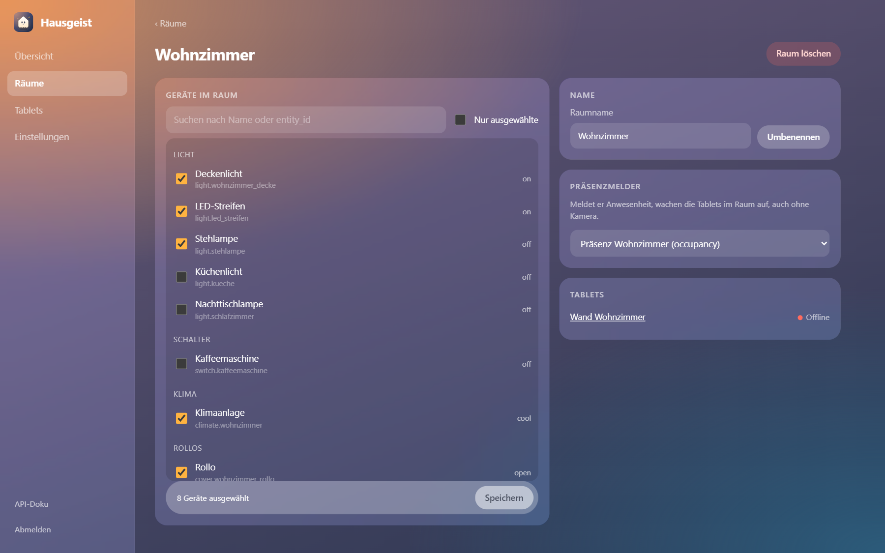
  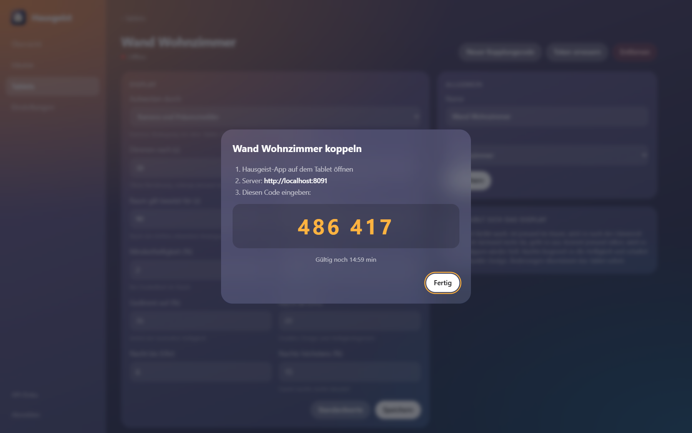
</p>

### 3. Tablet einrichten

1. Die APK aus den [Releases](https://github.com/gottschalkfelix4-source/hausgeist/releases/latest) aufs Tablet laden und installieren (Installation aus unbekannten Quellen erlauben).
   Per USB geht es auch mit `adb install -r hausgeist.apk`.
2. App öffnen, **Server-Adresse** (`http://<server>:8080`) und den **Kopplungscode** eintragen und auf **Verbinden** tippen.
   Der Code gilt nur einmal. Abgelaufen? In der Verwaltung beim Tablet auf **Neuer Kopplungscode** klicken.
   Ohne Server kannst du auf **Ohne Server ausprobieren (Demo)** tippen.
3. Kamera und Mikrofon erlauben.
4. **Kiosk-Modus:** Einmal die Home-Taste drücken und *Hausgeist* als Startbildschirm mit **Immer** wählen.
   Das Tablet startet dann direkt in die App, Status- und Navigationsleiste sind ausgeblendet.
5. Die Einrichtung erreichst du später über **langes Drücken auf die Uhr**.

**Bedienung:**

| Geste | Wirkung |
|---|---|
| Symbol antippen | Gerät ein oder aus |
| Kachel antippen | Detailfenster (Farbe, Modus, Lüfter, …) |
| Waagerecht über die Kachel wischen | Helligkeit oder Rollo-Position |
| Aktivierungswort sagen (z. B. „Computer“) | Sprechen, die Kugel öffnet sich |
| Mikro antippen | Sprechen ohne Aktivierungswort |
| Mikro lange drücken | Befehl eintippen |
| Kugel antippen / ✕ | Sofort abschicken / abbrechen |
| Lange auf die Uhr drücken | Einrichtung |

Raum, Geräte und Display-Einstellungen änderst du in der Verwaltung. Die Tablets übernehmen das sofort, ohne Neustart.

### Updates

**Server:** Unraid zeigt neue Images unter *Docker → Check for Updates*. Mit Compose: `docker compose pull && docker compose up -d`.

**App:** Gibt es auf GitHub ein neueres Release, zeigt das Tablet unten links **Update … verfügbar**. Antippen lädt
die APK im Browser, danach die Datei öffnen und installieren. Kopplung und Einstellungen bleiben erhalten.

> **Von 0.1.x auf 0.2.0:** Die App hat eine neue Paket-ID (`de.hausgeist.wall`) und ist jetzt mit einem
> festen Release-Schlüssel signiert. Sie wird deshalb **neben** der alten App installiert. Alte App
> deinstallieren, neue installieren und einmal koppeln. Ab 0.2.0 funktionieren Updates ganz normal.

## Web-Verwaltung

<p align="center">
  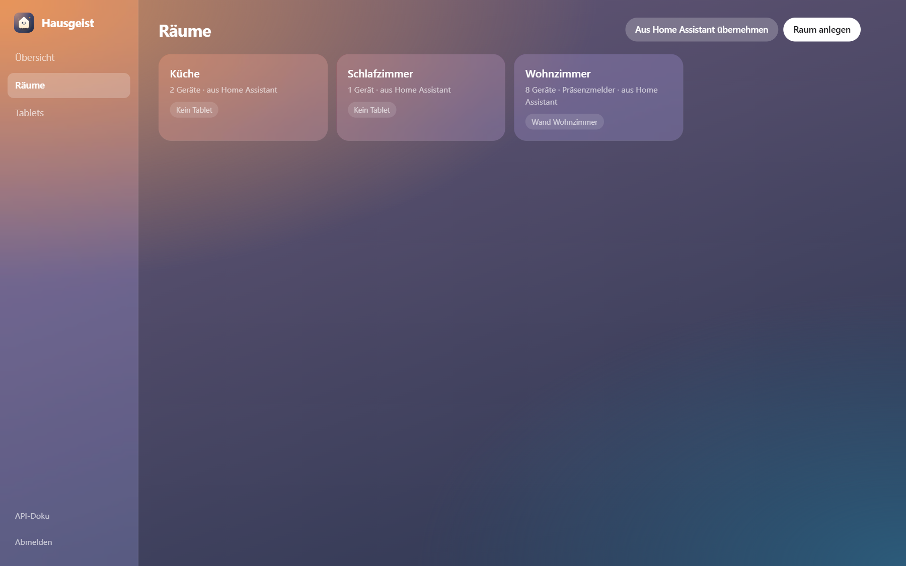
</p>

| Bereich | Was du dort machst |
|---|---|
| **Übersicht** | Verbindung zu Home Assistant, Status der Sprachdienste, welche Tablets online sind. Eine Checkliste zeigt, was bei der Einrichtung noch fehlt. |
| **Räume** | Bereiche aus Home Assistant übernehmen, Räume anlegen, umbenennen, löschen. Geräte per Suche und Häkchen zuordnen. Präsenzmelder wählen. |
| **Tablets** | Tablets anlegen und einem Raum zuweisen, auch mehrere pro Raum. Kopplungscode erzeugen, Token erneuern, Tablet entfernen. Display-Verhalten pro Tablet einstellen. |
| **Einstellungen → Home Assistant** | Adresse und Token ändern und testen. Hausgeist verbindet sich nach dem Speichern sofort neu, ohne Neustart. |
| **Einstellungen → Sprachassistent** | Betriebsart (klassisch oder Live-Sprachmodell), Sprachmodell, Stimme, Spracherkennung, API-Schlüssel und eigene Anweisungen an den Assistenten. Jeder Dienst hat einen **Testen**-Knopf, ElevenLabs-Stimmen lassen sich aus deinem Konto auswählen und probehören. Unter **Ausprobieren** schickst du einen Befehl wie vom Tablet eines Raums. Dort stellst du auch das **Aktivierungswort** und seine Empfindlichkeit ein. |
| **Einstellungen → System** | Update-Quelle, Sicherung herunterladen und wiederherstellen, Passwort ändern. |

<p align="center">
  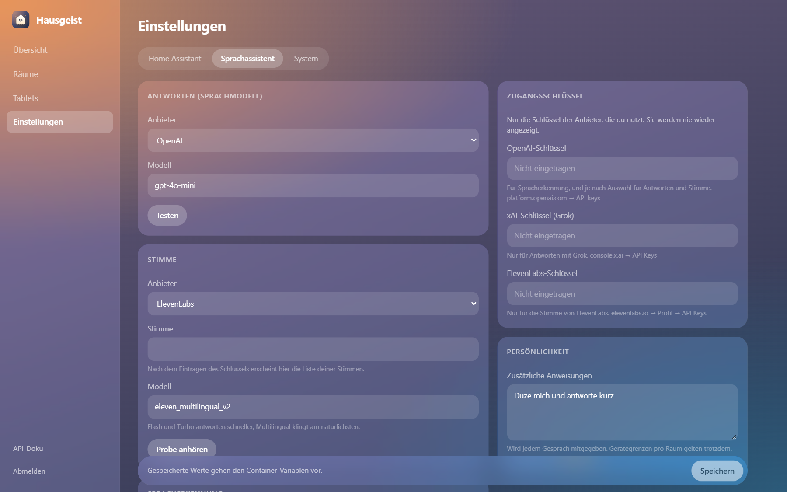
</p>

Die Verwaltung funktioniert auch auf dem Handy. Die Anmeldung bleibt nur in diesem Browser-Tab bestehen,
außer du setzt das Häkchen bei **Angemeldet bleiben**. Dann gilt sie 30 Tage ab der letzten Nutzung.

**API-Schlüssel** zeigt die Verwaltung nie wieder an, nur ob einer gesetzt ist. Zum Ändern einfach den neuen eintragen.

**Sicherung:** Unter *Einstellungen → System* lädst du eine JSON-Datei mit Räumen, Tablets und allen
Einstellungen herunter. Sie enthält **API-Schlüssel und Tablet-Tokens im Klartext**, also sicher aufbewahren.
Beim Wiederherstellen werden Räume, Tablets und Einstellungen ersetzt, die Tablets verbinden sich danach von selbst neu.
Das Passwort der Verwaltung ist nicht in der Sicherung.

**Passwort vergessen?** `ADMIN_KEY` im Container auf einen langen Wert setzen, neu starten, damit anmelden und
unter *Einstellungen → System* ein neues Passwort festlegen. Danach `ADMIN_KEY` wieder leeren.

## Display-Verhalten

Wenn lange niemand das Tablet bedient und niemand im Raum ist, geht der Bildschirm **ganz aus**. Sobald
die Kamera Bewegung sieht, der Präsenzmelder anschlägt oder jemand das Aktivierungswort sagt, geht er
wieder an. Verbindung, Kamera und Mikrofon laufen dabei im Hintergrund weiter (stille Benachrichtigung
„Hausgeist“).

Dafür braucht die App einmal die Freigabe als **Geräteadministrator**. Sie fragt beim ersten Start
danach, sonst: lange auf die Uhr tippen → *Bildschirm ganz ausschalten*. Genutzt wird davon nur
„Bildschirm sperren“. Die Displaysperre des Tablets muss auf *Keine* oder *Wischen* stehen. Mit PIN, Muster oder Passwort fragt Android nach dem Aufwachen danach; die Tablet-Einstellungen weisen darauf hin und öffnen die passende Android-Seite.
**Vor dem Deinstallieren** den Schalter wieder ausmachen, sonst lässt Android die App nicht löschen.
Ohne Freigabe heißt „aus“ wie bisher: Helligkeit 0 und schwarzer Bildschirm.

In einem stockdunklen Raum sieht die Kamera keine Bewegung. Zuverlässiger weckt dort ein Präsenzmelder
aus Home Assistant.

| Zustand | Wann | Helligkeit |
|---|---|---|
| **aktiv** | Berührung, Annäherung, gerade aufgewacht | passend zum Raumlicht |
| **gedimmt** | 30 s nicht bedient, aber jemand im Raum | ca. ein Drittel davon |
| **aus** | 120 s niemand bedient und niemand im Raum | 0 |

Damit es nicht flackert:
- Nach einer Bewegung gilt der Raum **90 s lang** als besetzt.
- Ein einzelnes verrauschtes Bild zählt nicht, es braucht mehrere Bilder mit Bewegung.
- Gleichmäßige Helligkeitsänderungen, etwa wenn das Licht angeht, gelten nicht als Bewegung.
- Nach dem Aufwachen bleibt das Display mindestens 20 s an.
- Aus dem gedimmten Zustand wird es nur hell, wenn sich jemand **nähert**, also mindestens 20 % des
  Kamerabilds sich ändern. Wer hinten im Raum vorbeigeht, ändert es nicht.
- Die Helligkeit folgt dem Lichtsensor gemittelt und mit Hysterese, damit sie nicht pumpt.

Nachts (standardmäßig 22–6 Uhr) oder in sehr dunklen Räumen gilt eine Obergrenze von 15 % und das Design
wird dunkel. Alle Werte lassen sich pro Tablet in der Verwaltung unter **Tablets** ändern, siehe
[ARCHITECTURE.md](docs/ARCHITECTURE.md#display-verhalten-dauer-wach-dimmen-nacht).

## Sprachassistent

```
Tablet ── Audio (WAV) ──► Server ── STT (OpenAI | Grok) ──► LLM (OpenAI | Grok | eigenes) ──► Werkzeug control_device
                                                                     │
Tablet ◄── Antwort + Audio ◄── TTS (ElevenLabs | OpenAI | Grok) ◄────┘
```

Das Sprachmodell bekommt nur die Geräte des Tablet-Raums mit ihrem aktuellen Zustand und kann nur diese steuern.
Es kann auch Farben und Weißtöne setzen. Pro Tablet merkt es sich die letzten Sätze für zwei Minuten.
Beispiele: *„Mach das Licht gemütlich“*, *„Stell die Klima auf 21 Grad“*, *„Rollo halb runter“*, danach *„noch ein bisschen weiter“*.

Anbieter, Modelle und Stimme stellst du in der Verwaltung unter *Einstellungen → Sprachassistent* ein:

| | Anbieter | Einstellbar |
|---|---|---|
| **Spracherkennung** | OpenAI oder xAI (Grok) | Modell (`gpt-4o-mini-transcribe`, `whisper-1`, `grok-voice-transcribe-2.0`, …), Sprache |
| **Sprachmodell** | OpenAI, xAI (Grok) oder **eigenes** | Modell. Eigenes = jeder OpenAI-kompatible Server, z. B. Ollama (`http://<ip>:11434/v1`) oder LM Studio. Das Modell muss Tool-Calling können, etwa `llama3.1` oder `qwen2.5`. |
| **Stimme** | ElevenLabs, OpenAI oder xAI (Grok) | ElevenLabs: Stimme aus deinem Konto, Modell. OpenAI: Modell, Stimme (`alloy`, `nova`, …). Grok: Stimme (`eve`, `ara`, `rex`, `leo`, … oder eine eigene geklonte) |

Ohne Stimme antwortet der Assistent nur mit Text auf dem Tablet.

### Live-Sprachmodell (GPT-Live, Grok Voice)

Statt der drei Bausteine kann ein **Live-Sprachmodell** die Aufnahme direkt hören und mit eigener Stimme
antworten. Das klingt natürlicher, mit Betonung und Pausen wie im Gespräch. Umstellen unter
*Einstellungen → Sprachassistent → Betriebsart*, mit **Probe anhören** hörst du die Stimme sofort.

| | GPT-Live-1 (OpenAI) | Grok Voice 3.0 (xAI) |
|---|---|---|
| Geräte schalten | gibt den Befehl an Hausgeist weiter, das eingestellte **Sprachmodell** schaltet | schaltet selbst über dasselbe Werkzeug |
| Stimmen | `marin` und 12 weitere, sprechen Deutsch mit leichtem Akzent (meist englisch) | `eve`, `ara`, `rex`, `leo` u. a. und eigene geklonte |
| Getippte Befehle | laufen über den klassischen Weg | laufen über Grok Voice |
| Preis (Stand Oktober 2026) | ca. 0,05 $ pro Minute, dazu das Sprachmodell bei Gerätebefehlen | ca. 0,08 $ pro Minute |

In beiden Fällen gelten dieselben Grenzen: nur Geräte des Tablet-Raums, dazu deine Anweisungen unter
**Persönlichkeit** und das Gesprächsgedächtnis. Antwortet das Live-Modell nicht, springt der klassische Weg
ein, sofern Spracherkennung und Sprachmodell eingerichtet sind.

Unter **Persönlichkeit** kannst du dem Assistenten zusätzliche Anweisungen geben, etwa *„Duze mich und antworte
in einem Satz.“* Die Regeln zur Gerätesteuerung bleiben davon unberührt.

### Aktivierungswort

Jedes Tablet hört ständig auf das Aktivierungswort, **ohne Internet und ohne Server**. Das erledigt ein kleines
Offline-Modell ([sherpa-onnx](https://github.com/k2-fsa/sherpa-onnx), 3,3 Mio. Parameter). Erst danach wird
aufgenommen. Die Aufnahme endet, sobald du eine knappe Sekunde nichts mehr sagst, und geht dann an den Server.
„Computer, mach das Licht an“ in einem Satz funktioniert auch.

**Welches Tablet antwortet?** Hören mehrere Tablets denselben Ruf, melden sie ihn dem Server. Der wartet einen
Augenblick (0,35 s) und lässt nur eins antworten:

1. das Tablet, bei dem gerade jemand ist: Die Kamera hat jemanden gesehen, das Tablet wurde berührt oder der
   Präsenzmelder des Raums meldet jemanden,
2. darunter bevorzugt eins, vor dem jemand direkt steht,
3. sonst das, bei dem der Ruf am lautesten ankam.

<p align="center">
  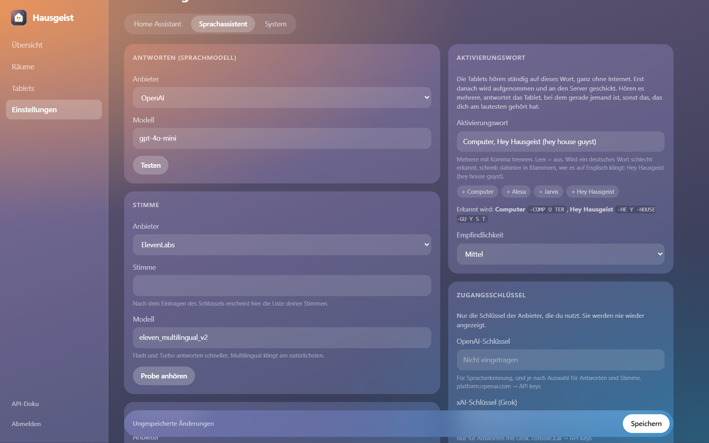
</p>

Eingestellt wird das in der Verwaltung unter *Einstellungen → Sprachassistent → Aktivierungswort*:

- **Wort:** Vorschläge sind *Computer*, *Alexa*, *Jarvis* und *Hey Hausgeist*. Mehrere Wörter trennst du mit Komma,
  leer schaltet die Funktion ab. Die Verwaltung zeigt, wie das Tablet das Wort zerlegt.
- **Eigene deutsche Wörter:** Das Modell kennt englische Laute. Wird ein Wort schlecht erkannt, schreib dahinter in
  Klammern, wie es auf Englisch klingt: `Hey Hausgeist (hey house guyst)`.
- **Empfindlichkeit:** *Hoch* reagiert auch leise und von weiter weg, löst aber öfter versehentlich aus.
- **Pro Tablet** lässt es sich unter *Tablets → Display* abschalten („Auf das Aktivierungswort hören“).

Gut zu wissen: Steckt das Wort in einem längeren Wort („Computerspiel“), kann es ebenfalls auslösen.
Kurze, ungewöhnliche Wörter mit zwei bis drei Silben funktionieren am besten.

## Konfiguration

Normalerweise stellst du alles in der Verwaltung ein. Jede Einstellung gibt es aber auch als
Umgebungsvariable (Unraid-Template oder `backend/.env`). **Was in der Verwaltung gespeichert ist, gilt vor
der Variable.** Neben jedem Feld steht, woher der aktuelle Wert kommt. Mit **Zurücksetzen** gilt wieder die Variable.

| Variable | Standard | Bedeutung |
|---|---|---|
| `HA_URL` | `http://homeassistant.local:8123` | Adresse von Home Assistant |
| `HA_TOKEN` | – | Long-Lived Access Token |
| `ADMIN_KEY` | – | Notfall-Zugang zur Verwaltung, zusätzlich zum Passwort. Auch für Skripte (`x-admin-key`). |
| `OPENAI_API_KEY` | – | OpenAI (STT, optional LLM, TTS und GPT-Live) |
| `XAI_API_KEY` | – | xAI / Grok (LLM, STT, TTS, Grok Voice) |
| `ELEVENLABS_API_KEY`, `ELEVENLABS_VOICE_ID` | – | ElevenLabs-Stimme |
| `ELEVENLABS_MODEL` | `eleven_flash_v2_5` | ElevenLabs-Modell (`eleven_multilingual_v2` klingt natürlicher, ist aber langsamer) |
| `STT_PROVIDER`, `STT_MODEL`, `STT_LANGUAGE` | `openai`, `gpt-4o-mini-transcribe`, `de` | Spracherkennung (`openai` oder `xai`) |
| `XAI_STT_MODEL` | `grok-voice-transcribe-2.0` | Spracherkennung für `xai` |
| `LLM_PROVIDER` | `openai` | `openai`, `xai` oder `custom` |
| `OPENAI_LLM_MODEL` | `gpt-4o-mini` | Modell für `openai` |
| `XAI_LLM_MODEL` | `grok-3-mini` | Modell für `xai` |
| `CUSTOM_LLM_URL`, `CUSTOM_LLM_API_KEY`, `CUSTOM_LLM_MODEL` | – | Eigenes OpenAI-kompatibles Sprachmodell |
| `TTS_PROVIDER` | `elevenlabs` | `elevenlabs`, `openai` oder `xai` |
| `OPENAI_TTS_MODEL`, `OPENAI_TTS_VOICE` | `gpt-4o-mini-tts`, `alloy` | Stimme für `openai` |
| `XAI_VOICE` | `eve` | Stimme für `xai` |
| `VOICE_MODE` | `pipeline` | `pipeline` (klassisch) oder `live` (Live-Sprachmodell) |
| `LIVE_PROVIDER` | `openai` | `openai` (GPT-Live) oder `xai` (Grok Voice) |
| `OPENAI_LIVE_MODEL`, `OPENAI_LIVE_VOICE` | `gpt-live-1`, `marin` | GPT-Live |
| `XAI_LIVE_MODEL`, `XAI_LIVE_VOICE` | `grok-voice-3.0`, `eve` | Grok Voice |
| `ASSISTANT_INSTRUCTIONS` | – | Zusätzliche Anweisungen an den Assistenten |
| `DB_PATH` | `/data/hausgeist.db` | SQLite-Datenbank |
| `UPDATE_REPO` | `gottschalkfelix4-source/hausgeist` | GitHub-Repo für den Update-Hinweis der App. Leer schaltet ihn ab. |
| `FORWARDED_ALLOW_IPS` | `127.0.0.1` | IP des Reverse Proxys, dem Hausgeist `X-Forwarded-For` glaubt |

## Zugriff von außen / HTTPS

Im Heimnetz reicht `http://`. Wer Hausgeist über das Internet erreichbar machen will, sollte einen
Reverse Proxy mit HTTPS davorsetzen, zum Beispiel **Nginx Proxy Manager** (gibt es als Unraid-App):

1. Neuer *Proxy Host*: Domain eintragen, *Forward* auf `http://<unraid-ip>:8080`.
2. **Websockets Support** einschalten. Ohne ihn kommen keine Live-Updates an.
3. Unter *SSL* ein Let's-Encrypt-Zertifikat anfordern und *Force SSL* aktivieren.
4. Im Container `FORWARDED_ALLOW_IPS` auf die IP des Proxys setzen. So zählt die Sperre gegen das
   Durchprobieren von Kopplungscodes und Passwörtern (10 Fehlversuche in 5 Minuten) pro echtem Gerät.
5. In der App als Server `https://deine-domain` eintragen.

Sicherheit im Überblick:
- Tablets melden sich mit einem eigenen Token an. Er geht im `Authorization`-Header mit, auch beim
  WebSocket, und landet so nicht in Proxy-Logs.
- Kopplungscodes gelten 15 Minuten und nur einmal.
- Die Verwaltung ist mit einem Passwort geschützt, das beim ersten Aufruf festgelegt wird. Gespeichert wird nur
  ein scrypt-Hash, Anmeldungen laufen über Sitzungs-Tokens, die beim Abmelden oder Passwortwechsel enden.
- Ein verlorenes Tablet entfernst du in der Verwaltung oder klickst dort **Token erneuern**.

## API

`x-admin-key` ist entweder das Sitzungs-Token aus `/api/admin/login` oder der `ADMIN_KEY`.

| Endpoint | Auth | Zweck |
|---|---|---|
| `GET/POST /api/setup` | – | Ist schon eingerichtet? Passwort beim ersten Start festlegen (danach 409) |
| `POST /api/admin/login`, `/api/admin/logout` | Passwort / `x-admin-key` | Anmelden, abmelden |
| `PUT /api/admin/password` | `x-admin-key` | Passwort ändern, beendet andere Sitzungen |
| `GET/PUT /api/settings` | `x-admin-key` | Einstellungen lesen (Schlüssel nur als „gesetzt“) und speichern, `null` setzt zurück |
| `POST /api/settings/test/{ha,llm,stt,tts,voices,xai_voices,live}` | `x-admin-key` | Dienst mit noch nicht gespeicherten Werten testen, Stimmen von ElevenLabs und Grok laden, Live-Modell probehören |
| `POST /api/voice/test` | `x-admin-key` | Sprachbefehl wie von einem Tablet im Raum |
| `GET/POST /api/backup` | `x-admin-key` | Sicherung herunterladen, wiederherstellen |
| `GET /api/status` | `x-admin-key` | Version, Home Assistant, Sprach-Provider, Tablets online |
| `GET/POST /api/rooms`, `PATCH/DELETE /api/rooms/{id}` | `x-admin-key` | Räume |
| `PUT /api/rooms/{id}/entities`, `PUT /api/rooms/{id}/presence` | `x-admin-key` | Geräte und Präsenzmelder eines Raums |
| `GET /api/ha/areas`, `POST /api/rooms/import-areas` | `x-admin-key` | Bereiche aus Home Assistant übernehmen |
| `GET /api/entities` | `x-admin-key` | Alle Geräte aus Home Assistant |
| `GET/POST /api/tablets`, `PATCH/DELETE /api/tablets/{id}` | `x-admin-key` | Tablets anlegen, Raum zuweisen, entfernen |
| `POST /api/tablets/{id}/pair`, `POST /api/tablets/{id}/token` | `x-admin-key` | Neuer Kopplungscode, Token erneuern |
| `PUT /api/tablets/{id}/display` | `x-admin-key` | Display-Verhalten pro Tablet |
| `POST /api/pair` | Kopplungscode | Liefert den Token für die App |
| `GET /api/wake/preview?word=` | `x-admin-key` | Zeigt, wie ein Aktivierungswort für das Tablet zerlegt wird |
| `GET /api/me` | Tablet-Token | Raum, Geräte, Display-Einstellungen und Aktivierungswort |
| `POST /api/entities/{id}/command` | Tablet-Token | Gerät steuern (nur im eigenen Raum) |
| `WS /ws` | Tablet-Token im Header | Live-Zustände, Aufwecken, Wahl des antwortenden Tablets (`wake_heard` → `wake_result`) |
| `POST /api/voice/text`, `/api/voice/audio` | Tablet-Token | Sprachassistent |
| `GET /api/app/update` | Tablet-Token | Neueste App-Version |
| `GET /health` | – | Status |

Die vollständige, interaktive Doku liegt auf jedem Server unter `/docs`.

## Entwicklung

```
backend/   FastAPI-Server (Python 3.12)
app/       Flutter-App für Android
unraid/    Unraid-Template
docs/      Architektur, Logo, Screenshots
```

**Server lokal:**
```bash
cd backend
python -m venv .venv && .venv/Scripts/activate   # Linux/macOS: source .venv/bin/activate
pip install -r requirements-dev.txt
cp .env.example .env               # optional
DB_PATH=./hausgeist.db uvicorn app.main:app --reload --port 8080
python -m pytest                     # API, Kopplung, Raum-Grenzen, Sprach-Werkzeuge, Einstellungen, Sicherung
```

Die Verwaltung (`backend/app/admin/`) ist reines HTML, CSS und JavaScript ohne Build-Schritt.

**App:**
```bash
cd app
flutter test                  # Display-Logik, Gerätemodell, Oberfläche
flutter build apk --release --target-platform android-arm,android-arm64   # build/app/outputs/flutter-apk/app-release.apk
```

Die Display-Logik (`app/lib/display/display_controller.dart`) ist reines Dart und vollständig getestet.

**Signieren:** Ohne Schlüssel signiert Gradle mit dem Debug-Schlüssel, das reicht zum Ausprobieren.
Für Releases liest `app/android/app/build.gradle.kts` entweder `app/android/key.properties`
(`storeFile`, `storePassword`, `keyAlias`, `keyPassword`, nicht im Repo) oder die Umgebungsvariablen
`HAUSGEIST_KEYSTORE`, `HAUSGEIST_KEYSTORE_PASSWORD`, `HAUSGEIST_KEY_ALIAS` und `HAUSGEIST_KEY_PASSWORD`.

**Release:** Version in `app/pubspec.yaml` und `backend/app/__init__.py` erhöhen, dann einen Tag `vX.Y.Z` pushen.
Die CI testet Server und App, baut das Docker-Image und hängt die signierte `hausgeist-X.Y.Z.apk` ans Release.
Den Schlüssel bekommt sie aus den Secrets `HAUSGEIST_KEYSTORE_BASE64` und `HAUSGEIST_KEYSTORE_PASSWORD`.

## Datenschutz

- **Kamera:** Die Bilder werden nur im Arbeitsspeicher des Tablets auf ein 32×24-Raster verkleinert
  und verglichen. Sie werden nie gespeichert oder verschickt.
- **Sprache:** Auf das Aktivierungswort hört das Tablet selbst, dabei verlässt nichts das Gerät. Erst nach dem
  Aktivierungswort (oder dem Tippen aufs Mikro) wird aufgenommen. Diese Aufnahme geht an deinen Server und von
  dort an die gewählten Anbieter (OpenAI, xAI, ElevenLabs). Ohne API-Keys ist der Sprachassistent aus.
- **Keine Cloud nötig** für die Gerätesteuerung: Tablets, Server und Home Assistant reden nur im Heimnetz.

## Roadmap

- [x] Server mit Räumen, Tablets, Live-Updates und Sprachassistent
- [x] Tablet-App mit Apple-Home-Design, Detailfenstern und Display-Logik
- [x] Unraid-Template und Docker-Image
- [x] Web-Oberfläche zur Verwaltung (Räume, Tablets, Präsenzmelder, Display-Einstellungen)
- [x] Einrichtung und alle Einstellungen im Browser, Einrichtungsassistent, Sicherung
- [x] Bereiche aus Home Assistant automatisch als Räume übernehmen
- [x] Koppeln per Code, signierte Releases, Update-Hinweis in der App
- [x] Gesprächsgedächtnis für den Sprachassistenten
- [x] Aktivierungswort (frei wählbar, offline) mit Wahl des nächsten Tablets und animierter Sprach-Kugel
- [x] Live-Sprachmodelle (GPT-Live-1, Grok Voice 3.0), Grok als Stimme und Spracherkennung
- [ ] Antwort gestreamt abspielen, während sie noch erzeugt wird

## Lizenz

[MIT](LICENSE) © 2026 Felix Gottschalk
